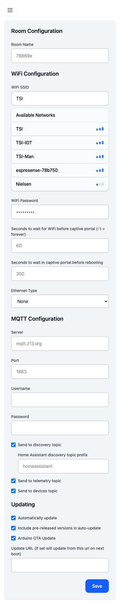

On first boot after flashing, the ESP32 launches a captive Wi-Fi portal under its own SSID. Join it, enter your network and MQTT credentials, and the device will reboot onto your network. These same fields stay editable from the **Network** page in the device web UI.

The configuration AP is named `espresense-<room>` (for example `espresense-a1b2c3` when the room is the default chip MAC) and is open unless **Configuration AP Password** is set. To update firmware or recover Wi-Fi remotely, see [Remote updates and Wi-Fi recovery](/guides/remote-updates).

## Room Configuration

* **Room name** — used as the node's identity in Home Assistant and as the `<room>` segment of every MQTT topic. Spaces and case are normalised to a slug for the topic; the original is preserved for display.

## Wi-Fi Configuration

* **Wi-Fi SSID** — the network to join.
* **Available Networks** — live scan list.
* **Wi-Fi Password** — WPA2 passphrase. Stored unencrypted on the device.
* **Configuration AP Password** (`ap-password`, default empty) — WPA2 passphrase for the fallback configuration AP. Must be 8–63 characters; empty or shorter leaves the AP open.
* **Seconds to wait for WiFi before captive portal** (`wifi_timeout`, default `60`s) — `-1` waits forever instead of falling back to the portal.
* **Seconds to wait in captive portal before reboot** (`portal_timeout`, default `300`s).
* **Ethernet Type** — select your Ethernet connection type if the board has an Ethernet PHY (Olimex POE, M5Stack PoE Atom, etc.). Leave blank for Wi-Fi-only nodes.

## MQTT Configuration

* **Server** — MQTT broker hostname or IP (e.g. `mqtt.example.com`). **TLS is not supported**; the connection is plaintext.
* **Port** — broker port (`mqtt_port`, default `1883`).
* **Username** — optional. Because the link is unencrypted, credentials transit in plaintext — only use these on trusted networks.
* **Password** — optional.
* **Send to discovery topic** (`discovery`, default on) — publish Home Assistant MQTT-discovery payloads on connect.
* **Home Assistant discovery topic prefix** (`discovery_prefix`, default `homeassistant`) — only change if your HA install uses a non-default prefix.
* **Send to telemetry topic** (`pub_tele`, default on) — emit `<room>/telemetry` JSON (uptime, free heap, scan counters). Required for the count sensor.
* **Send to devices topic** (`pub_devices`, default on) — emit per-device distances to `espresense/devices/<id>/<room>`. This is the topic shape Home Assistant's `mqtt_room` integration consumes.

## Updating

* **Automatically update** (`auto_update`, default off) — check GitHub for new firmware on a 15-minute interval and flash if available. The node keeps its current firmware flavor.
* **Include pre-release versions in auto-update** (`prerelease`, default off) — also accept pre-release builds.
* **Arduino OTA Update** (`arduino_ota`, default off) — listen for the Arduino OTA / espota protocol. Keep off for less RAM use and a smaller attack surface. There is no OTA password.
* **Update URL** (`update`, default empty) — if set, the node fetches firmware from this `http(s)://` URL on next boot. A value that doesn't start with `http` means “use the built-in release URL”. Cleared after a successful update, and also after a failure (the reason is published to `update_error`).

Commands and failure troubleshooting live in [Remote updates and Wi-Fi recovery](/guides/remote-updates).

For scanning, counting, filtering, and calibration options, see [Settings](/configuration/settings). For LED and GPIO sensors, see [Hardware](/configuration/hardware). For the full MQTT topic list (including every setting in this page) see [MQTT](/configuration/mqtt).

---

*Last verified against firmware source [`main` @ `8f9306f`](https://github.com/ESPresense/ESPresense/commit/8f9306f) on 2026-11-10.*
